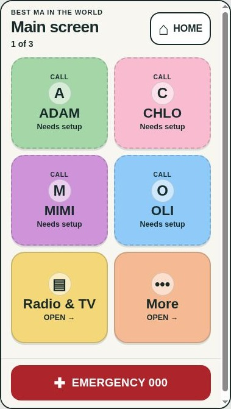

# Validation — 28 October 2026

These results apply to repository code and the cloud Chrome browser. No iPhone was connected, installed, configured or used for these checks. The branch is a reviewable implementation, not a claim of a live update.

## Automated checks

`node --check app.js`, `node --test tests/safety.test.cjs` (9 passing tests), and `git diff --check` passed. Both archived originals match the source at commit `638a36239bda7b7f63615e346c951778e6544647` byte-for-byte. Existing icons were left unchanged. The normal static build succeeds without packages.

The tests cover preserved numbers/colours, unverified destinations, malformed/future dates, unsafe URL schemes, local photo paths, duplicate IDs, six-tile navigation, resume/history recovery, cancellation/focus, rapid tap and repeat-launch guards, configuration failure, AA colour contrast and enabled native zoom. The DOM harness exercises application events; it is not an iOS browser emulator.

## Browser viewport checks

The browser loaded the actual launcher in same-origin iframes of the dimensions below. Each size was measured at 100% and 200% root text size. This approximates CSS layout at those sizes; it does not simulate actual Dynamic Type, Safari chrome, zoom physics, notches or Home indicators.

| CSS viewport | Text | Horizontal overflow | Targets below 44 px | Expected behavior |
| --- | --- | --- | --- | --- |
| 320 × 568 | 100% | None | 0 | All six tiles above emergency bar |
| 375 × 548 | 100% | None | 0 | All six tiles above emergency bar |
| 375 × 667 | 100% | None | 0 | All six tiles above emergency bar |
| 390 × 844 | 100% | None | 0 | All six tiles above emergency bar |
| 430 × 932 | 100% | None | 0 | All six tiles above emergency bar |
| 667 × 375 | 100% | None | 0 | Vertical scrolling; HOME and emergency remain available |
| 320 × 568 | 200% | None | 0 | Vertical scrolling; HOME and emergency remain available |
| 375 × 548 | 200% | None | 0 | Vertical scrolling; HOME and emergency remain available |
| 375 × 667 | 200% | None | 0 | Vertical scrolling; HOME and emergency remain available |
| 390 × 844 | 200% | None | 0 | Vertical scrolling; HOME and emergency remain available |
| 430 × 932 | 200% | None | 0 | Vertical scrolling; HOME and emergency remain available |
| 667 × 375 | 200% | None | 0 | Vertical scrolling; HOME and emergency remain available |

Normal portrait view shows all six tiles without scrolling to reach them. Some compact views retain a small amount of blank scroll space below content to protect the footer. At enlarged text and in landscape, content scrolls rather than truncating. Larger text reflows into a single tile column on supporting browsers. Labels are not made small to force everything onto one screen.

Manually checked in the browser: both supplementary screens; HOME from each; unverified call setup panel with no call link; cancel and focus return; emergency confirmation showing `tel:000` without activating it; keyboard focus wrapping and Escape; verified fixture exposing the preserved contact URI; external HTTPS fixture with a separate target/no opener; invalid and missing configuration messages; navigating More and returning HOME at 320 × 568 with 200% text. No actual contact call, emergency call or external site action was triggered.

Automated tests cover rapid repeats and history/visibility handlers. Physical accidental taps, long-press behavior and iOS app switching still need a phone trial. No axe/VoiceOver audit or WebKit/device certification is claimed.

Full QA screenshot: [ma-phone-main-20261028.jpg](ma-phone-main-20261028.jpg). Raw measurements: [viewport-results.json](viewport-results.json).

## Still required on Ma’s phone

Model/iOS identification, current shortcut/contact verification, approved photographs and final labels, deployed URL/version, Safari install, VoiceOver, pinch/text settings, safe areas, native Phone/Safari handoff and return, incoming/outgoing ordinary calls, offline/native fallback, restart, and the native-protection trial. Follow [IPHONE_SETUP.md](IPHONE_SETUP.md). All remain pending.

A website cannot lock the native Home Screen. Guided Access is not recommended as an everyday solution because of its single-app and emergency restrictions. Native controls are assessed in the setup guide, with Apple sources.
